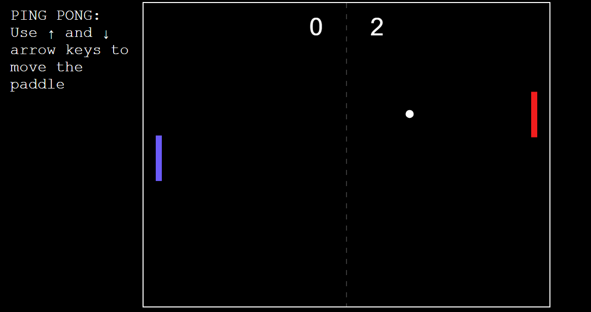

# Ping Pong!

Play Pong! This is a recreation / implementation of the classic pong game, that you can play with the computer. Don't slack off! The bot won't go easy on you.

You lose a point if the the ball hits your side of the wall and gain a point when the opposite happens. Guard your side, play for as like as you like.

To reset the scores, refresh the page.

**Controls**: Use up and down arrows to move your paddle

Demo link: https://sawfan1.github.io/ping-pong/

# Game Screenshot

# Development

The website uses the trio HTML, CSS and JS to render and function properly. The computer AI was the hardest to create. The game logic is inside `index.js` and is responsible for moving the paddle, updating positions, drawing the animations, handling input and counting scores.

Don't forget to star the project if you enjoyed playing!
